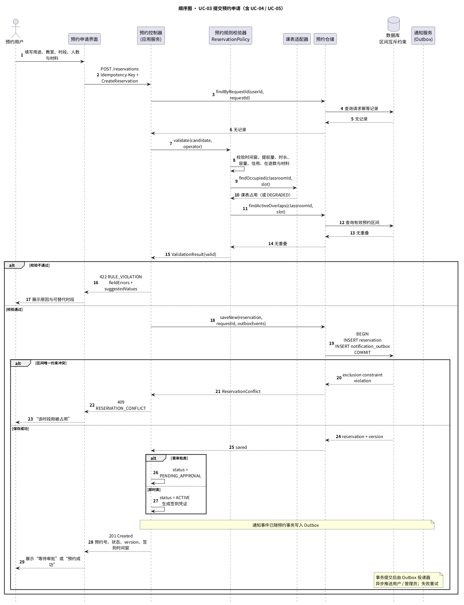
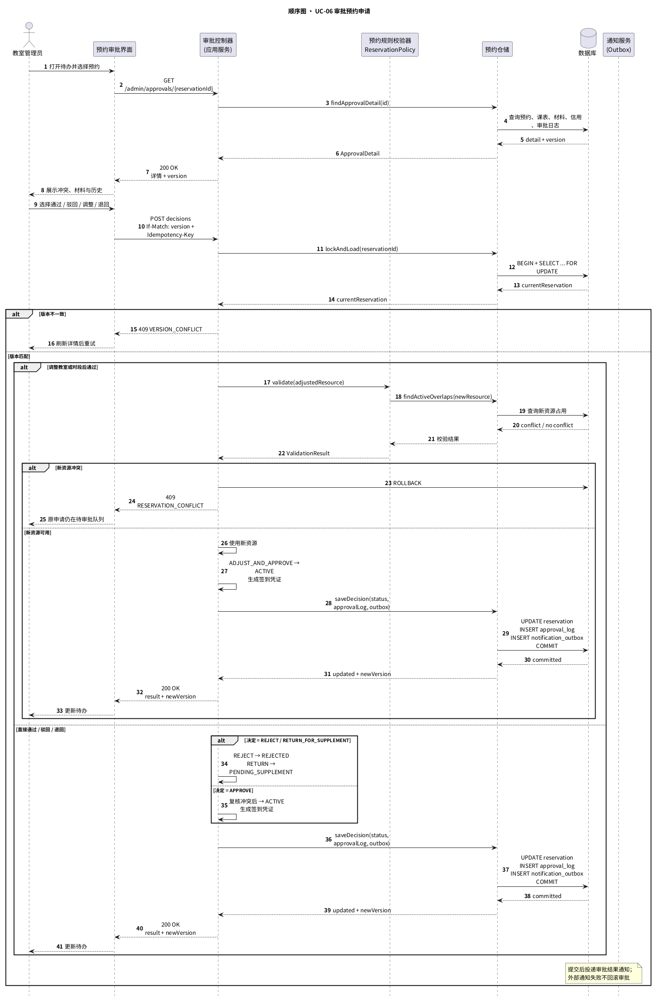
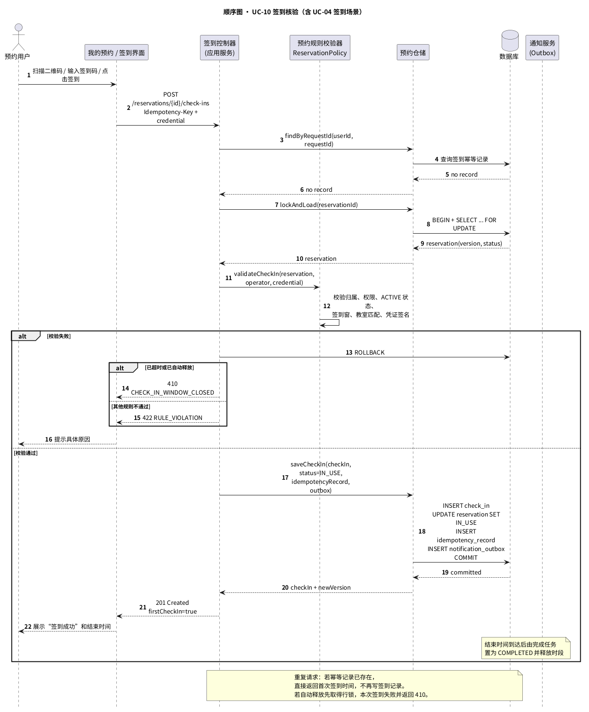
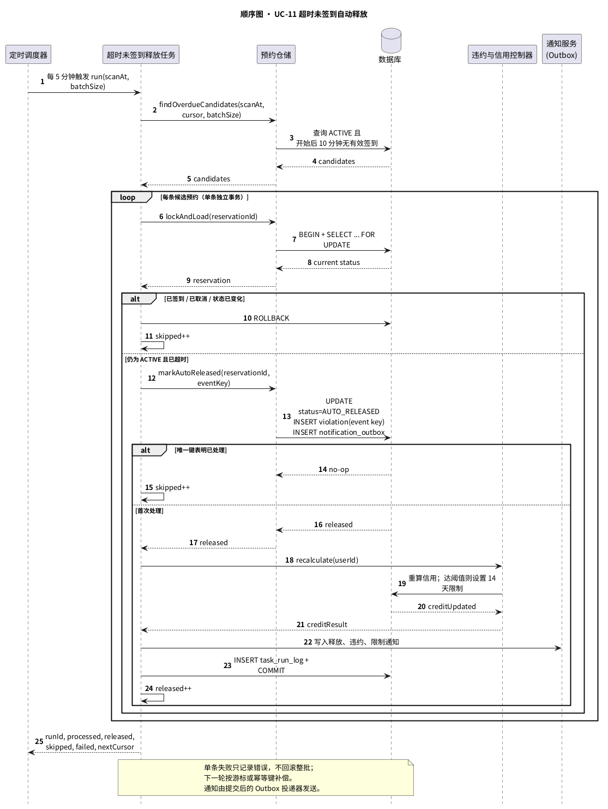

# 校园空教室预约管理系统 · 接口设计与顺序图

| 项目 | 内容 |
| --- | --- |
| 课程 | 面向对象设计与分析 · 学期课设 |
| 选题 | 校园空教室预约管理系统（CFRMS） |
| 阶段 | 系统设计（OOA 分析模型 → OOD 设计模型） |
| 交付物 | 接口设计说明、核心顺序图 |
| 上游模型 | `../user-case-analysis/用况分析.md`、`../class-analysis/类图分析.md` |
| 版本 | v1.0 |

---

## 1 接口设计

### 1.1 通用约定

| 项目 | 约定 |
| --- | --- |
| 协议与编码 | HTTPS + JSON，UTF-8；对外基础路径 `/api/v1`，内部任务路径 `/internal/v1` |
| 认证 | OIDC Authorization Code + PKCE；业务请求使用 `Authorization: Bearer <access_token>`，本系统不接收或保存统一身份认证口令 |
| 授权 | 角色 + 资源归属双重校验；用户只能读取 / 操作本人预约，管理员接口要求相应权限码 |
| 时间 | ISO-8601 带时区，例如 `2026-10-24T08:00:00+08:00`；区间统一采用左闭右开 |
| 标识 | 预约、教室、用户、文件均使用 UUID；对外不暴露数据库自增主键 |
| 幂等 | 写命令使用 `Idempotency-Key`；服务端保存至少 24 小时 |
| 并发 | 可变更资源返回 `version`；命令使用 `If-Match: "<version>"` |
| 分页 | 游标分页：`cursor`、`limit`（默认 20，最大 100），响应返回 `nextCursor` |
| 错误结构 | 使用 `application/problem+json` 风格；同时保留 HTTP 状态码与稳定业务错误码 |
| 日志脱敏 | 手机号仅显示后四位；签到码、访问令牌、材料内容不得写入日志 |
| 限流 | 登录、查询、创建预约、签到分别限流；返回 `Retry-After` |

接口层的一致性规则如下：写命令使用请求幂等键；可变更资源使用版本号与 `If-Match` 做乐观并发控制；同一教室同一时段由数据库区间排除约束保证互斥；预约状态、审批日志与通知 Outbox 在同一事务提交，外部通知失败通过重试补偿。

成功响应：

```json
{
  "data": {
    "id": "c63d4f07-b1ec-4b5f-ac4b-61c88bd77ba7",
    "status": "PENDING_APPROVAL",
    "version": 3
  },
  "requestId": "req-01J9M6T8N4"
}
```

失败响应：

```json
{
  "type": "https://cfrms.example/problems/reservation-conflict",
  "title": "预约时段已被占用",
  "status": 409,
  "code": "RESERVATION_CONFLICT",
  "detail": "该教室在所选时段已被其他预约占用",
  "fieldErrors": [],
  "requestId": "req-01J9M6T8N4"
}
```

### 1.2 对外 REST 接口清单

| 用况 | 方法与路径 | 权限 | 作用 |
| --- | --- | --- | --- |
| UC-01 | `POST /api/v1/auth/sessions` | 公开 | 用 SSO 授权码交换本系统会话，加载角色权限 |
| UC-01 | `DELETE /api/v1/auth/sessions/current` | 已登录 | 注销当前会话 |
| UC-01 | `GET /api/v1/me` | 已登录 | 查询当前用户、角色、权限与限制状态 |
| UC-02 | `GET /api/v1/classrooms/available` | 预约用户 | 查询指定时段的空教室及数据时效 |
| UC-03 | `POST /api/v1/reservations` | 预约用户 | 创建预约；自动校验并占用时段 |
| UC-05 | `POST /api/v1/files` | 预约用户 | 上传证明材料，返回受控文件标识 |
| UC-06 | `GET /api/v1/admin/approvals` | 教室管理员 | 分页查询审批待办，可按教室 / 时段筛选 |
| UC-06 | `POST /api/v1/admin/reservations/{id}/decisions` | 教室管理员 | 通过、驳回、调整后通过、退回补充 |
| UC-07 | `POST /api/v1/reservations/{id}/cancellation` | 本人 | 取消预约并按规则判断是否违约 |
| UC-08 | `POST /api/v1/reservations/{id}/changes` | 本人 | 变更教室或时段，必要时重新审批 |
| UC-09 | `GET /api/v1/reservations` | 本人 | 查询本人预约，支持状态与日期筛选 |
| UC-09 | `GET /api/v1/reservations/{id}` | 本人或管理员 | 查询预约详情与签到凭证 |
| UC-10 | `POST /api/v1/reservations/{id}/check-ins` | 本人 / 代签管理员 | 扫码、签到码或管理员代签 |
| UC-11 | `POST /internal/v1/jobs/overdue-check-ins/run` | 内部调度凭据 | 分批扫描并释放超时未签到预约 |
| UC-12 | `POST /api/v1/admin/violations/{id}/revocation` | 教室管理员 | 撤销有正当理由的违约并重算信用 |
| UC-13 | `GET/POST/PATCH /api/v1/classrooms` | 教室管理员 | 查询、创建、修改教室与开放规则 |
| UC-14 | `POST /api/v1/admin/schedule-syncs/run` | 系统管理员 | 手动触发课表同步，并返回同步批次 |
| UC-15 | `GET/PATCH /api/v1/admin/users/{id}` | 系统管理员 | 维护角色、权限与账号状态 |
| UC-16 | `GET /api/v1/reports/classroom-usage` | 管理员 / 教务人员 | 查询使用率、空置率、违约率 |
| UC-16 | `POST /api/v1/reports/classroom-usage/exports` | 管理员 / 教务人员 | 创建异步导出任务 |
| UC-17 | 无公开接口 | 内部 | 由 `NotificationPort` 和 Outbox 投递器实现 |

UC-04 是内部规则服务，不对浏览器开放独立端点；所有创建、变更、审批调整和签到路径都必须调用同一个 `ReservationPolicy`。

### 1.3 核心请求与响应结构

#### 1.3.1 查询空教室：`GET /api/v1/classrooms/available`

| 参数 | 类型 | 必填 | 约束 / 含义 |
| --- | --- | --- | --- |
| `startAt` | date-time | 是 | 查询区间开始 |
| `endAt` | date-time | 是 | 查询区间结束，必须晚于开始且不超过 4 小时 |
| `buildingId` | UUID | 否 | 楼栋筛选 |
| `minCapacity` | integer | 否 | 最小容量，≥ 1 |
| `classroomType` | enum | 否 | 普通教室、机房、研讨室等 |
| `equipmentCodes` | string[] | 否 | 必须同时具备的设备编码 |
| `sort` | enum | 否 | `CAPACITY_ASC`、`BUILDING_ROOM`，默认楼栋 / 房号 |

响应中的每间教室包含 `classroomId`、`buildingName`、`roomNo`、`capacity`、`equipment`、`availableIntervals`、`requiresApproval`、`dataQuality`。`dataQuality = DEGRADED` 表示课表同步异常，此时按已有预约和教室状态降级计算，并返回 `scheduleUpdatedAt` 与提示文案。

#### 1.3.2 创建预约：`POST /api/v1/reservations`

请求头：

```text
Authorization: Bearer <token>
Idempotency-Key: 3f57c1c0-93fa-49b7-92cb-9548e95bd213
Content-Type: application/json
```

请求体：

```json
{
  "purposeCode": "GROUP_DISCUSSION",
  "classroomId": "c63d4f07-b1ec-4b5f-ac4b-61c88bd77ba7",
  "startAt": "2026-10-24T14:00:00+08:00",
  "endAt": "2026-10-24T16:00:00+08:00",
  "attendeeCount": 24,
  "contactPhone": "13800000000",
  "hasExternalParticipants": false,
  "materialFileIds": [],
  "note": "课程小组讨论"
}
```

| 字段 | 规则 |
| --- | --- |
| `purposeCode` | 取自用途类别枚举；直接决定是否审批、是否要求材料与最早提前量 |
| `classroomId` | 必须是可预约、未停用的教室 |
| `startAt` / `endAt` | 未来 1~14 天；单次不超过 4 小时；即时类提前 30 分钟，需审批类提前 4 小时 |
| `attendeeCount` | 1～教室容量；不能超过容量 |
| `contactPhone` | 仅用于本次预约联系，响应中脱敏 |
| `materialFileIds` | 活动类或含校外人员参与时至少一项；文件须属于当前用户且未过期 |

成功返回 `201 Created`，`data` 至少包含：

| 字段 | 说明 |
| --- | --- |
| `id` | 预约 UUID |
| `status` | `ACTIVE` 或 `PENDING_APPROVAL` |
| `requiresApproval` | 是否需要管理员审批 |
| `version` | 后续操作使用的版本号 |
| `checkInWindow.startAt/endAt` | 签到时间窗；待审批申请在生效后才激活 |
| `checkInToken` | 仅返回给预约本人，可通过二维码展示；日志不得记录 |
| `nextAction` | 前端下一步提示，如“前往签到”或“等待审批” |

同级同时存在待审批申请时，是否合并为 `suggestedAlternativeSlots` 由响应返回，前端只展示，不自行判定冲突。

#### 1.3.3 审批预约：`POST /api/v1/admin/reservations/{id}/decisions`

请求头必须包含 `If-Match: "<version>"` 与 `Idempotency-Key`。

```json
{
  "decision": "APPROVE",
  "reason": "教室与该活动规模匹配",
  "adjustedResource": null
}
```

| `decision` | 必填字段 | 结果 |
| --- | --- | --- |
| `APPROVE` | `reason` 可选 | 复核通过后 `ACTIVE`，生成签到凭证与通知 |
| `REJECT` | `reason` 必填 | `REJECTED`，释放时段并记录审批日志 |
| `RETURN_FOR_SUPPLEMENT` | `reason` 必填 | `PENDING_SUPPLEMENT`，保留时段 24 小时 |
| `ADJUST_AND_APPROVE` | `adjustedResource` 必填 | 按新教室 / 时段重新执行 UC-04，通过后 `ACTIVE` |

`adjustedResource` 包含 `classroomId`、`startAt`、`endAt`。版本落后返回 `VERSION_CONFLICT`；目标资源已被占用返回 `RESERVATION_CONFLICT`，原申请仍保持待审批。

#### 1.3.4 签到：`POST /api/v1/reservations/{id}/check-ins`

```json
{
  "method": "QR_CODE",
  "classroomId": "c63d4f07-b1ec-4b5f-ac4b-61c88bd77ba7",
  "credential": "signed-check-in-token",
  "assistedReason": null
}
```

| 规则 | 说明 |
| --- | --- |
| 预约归属 | 操作人必须是预约人；管理员代签须具备 `CHECK_IN_ASSIST` 权限并填写 `assistedReason` |
| 状态 | 只接受 `ACTIVE`；已签到返回首次签到结果，已释放返回 `CHECK_IN_WINDOW_CLOSED` |
| 时间窗 | 开始前 15 分钟至开始后 10 分钟，服务端使用统一时钟判断 |
| 凭证 | 验证签名、预约号、教室与有效期，不把原始令牌写日志 |
| 幂等与并发 | 同一预约只产生一条有效签到记录；行锁避免签到与自动释放同时成功 |

成功返回 `201 Created`，包含 `checkInId`、`checkedInAt`、`method`、`firstCheckIn`；重复请求返回首次结果并将 `firstCheckIn` 标为 `false`。

#### 1.3.5 超时释放任务：`POST /internal/v1/jobs/overdue-check-ins/run`

```json
{
  "scanAt": "2026-10-24T14:11:00+08:00",
  "batchSize": 200,
  "cursor": null
}
```

响应包含 `processed`、`released`、`skipped`、`failed`、`nextCursor` 与 `runId`。任务只使用内部调度凭据，不接受普通用户令牌；失败批次由下一轮扫描补偿。

### 1.4 统一错误码

| HTTP | 业务码 | 场景 |
| --- | --- | --- |
| 400 | `INVALID_ARGUMENT` | 日期格式、必填字段或枚举值错误 |
| 401 | `AUTH_REQUIRED` | 未登录、令牌过期或 SSO 会话无效 |
| 403 | `FORBIDDEN` | 越权读取他人预约或缺少管理权限 |
| 404 | `RESOURCE_NOT_FOUND` | 预约、教室或文件不存在 |
| 409 | `RESERVATION_CONFLICT` | 目标教室时段已被占用 |
| 409 | `IDEMPOTENCY_CONFLICT` | 同一幂等键提交了不同载荷 |
| 409 | `VERSION_CONFLICT` | `If-Match` 版本已过期 |
| 409 | `INVALID_STATE_TRANSITION` | 对已签到、已取消等状态执行不允许的操作 |
| 410 | `CHECK_IN_WINDOW_CLOSED` | 签到窗已关闭或预约已自动释放 |
| 422 | `RULE_VIOLATION` | 时间窗、容量、信用、材料等在途规则不满足 |
| 429 | `RATE_LIMITED` | 超过接口限流阈值 |
| 503 | `DEPENDENCY_UNAVAILABLE` | 认证 / 课表依赖不可用且无法降级 |

`RULE_VIOLATION` 的 `fieldErrors` 逐项返回 `field`、`ruleCode`、`message` 与可选 `suggestedValues`，便于前端定位错误；不得只返回笼统的“校验失败”。

### 1.5 内部端口与外部系统接口

| 端口 | 方法契约 | 实现 / 边界 | 失败策略 |
| --- | --- | --- | --- |
| `IdentityPort` | `exchange(code) -> Identity`、`introspect(token) -> Identity` | 统一身份认证适配器 | 认证失败直接拒绝，不降级 |
| `ScheduleOccupancyPort` | `findOccupied(classroomIds, slot, semester) -> Occupancy[]` | 教务排课适配器 + 本地缓存 | 查询可降级，返回 `dataQuality = DEGRADED` 并告警 |
| `ReservationRepository` | `findById`、`findOverlaps`、`saveNew`、`lockAndLoad`、`update` | 数据库仓储 | 冲突由区间约束裁决 |
| `NotificationPort` | `schedule(NotificationCommand) -> OutboxId` | Outbox + 短信 / 微信 / 邮件适配器 | 事务内只写 Outbox；外部失败指数退避重试 |
| `FileStoragePort` | `issueUploadUrl`、`verifyOwnership`、`deleteExpired` | 对象存储 | 上传失败不影响已有预约；材料未确认前不可提交 |
| `ClockPort` | `now() -> Instant` | 系统时钟 | 测试可注入固定时钟，统一时区语义 |
| `StatsExportPort` | `createJob(query) -> ExportTaskId` | 报表任务 / 对象存储 | 异步重试，完成后通知下载地址 |

外部接口统一使用适配器，领域层只依赖端口。适配器负责把第三方字段映射为内部值对象，并把超时、限流、鉴权失败转换为稳定的业务错误；不得把第三方原始错误结构直接透传给调用方。

### 1.6 安全与隐私设计

1. 统一身份认证只返回身份标识、身份类型、姓名与院系等必要字段；本系统不保存口令。
2. 预约详情仅允许本人、具备审批权限的教室管理员及授权审计人员访问。
3. 手机号、签到令牌、证明材料内容按字段权限脱敏；导出报表默认不包含个人联系方式。
4. 所有审批、违约、权限变更和代签操作写入不可篡改的审计日志，记录操作人、时间、对象、结论与请求号。
5. 证明材料设置格式、大小、病毒扫描和保留期；超出保留期自动清理，满足 BR-11、BR-12 与隐私最小化原则。

---

## 2 顺序图

以下 4 张顺序图与用况分析中的核心活动图对应。图中边界类、控制类、实体类名称与 `类图分析.md` 保持一致，同时补充设计阶段的仓储、数据库和外部适配器。

### 2.1 UC-03 提交预约申请



关键路径：

1. 前端为每次“提交预约”生成 `Idempotency-Key`，控制器先查重，避免网络重试生成两条记录。
2. `ReservationPolicy` 依次校验时间窗、提前量、容量、信用、在途数量和证明材料，再查询课表占用与已有预约。
3. 校验通过后在事务中插入预约及 Outbox 事件；区间排除约束负责最终并发裁决。
4. 即时类直接进入 `ACTIVE`，需审批类进入 `PENDING_APPROVAL`；事务提交后才由 Outbox 投递通知。

异常路径：规则不通过返回 `422 RULE_VIOLATION` 并给出可替代时段；数据库检测到区间冲突返回 `409 RESERVATION_CONFLICT`；重复幂等键返回首次创建结果。

### 2.2 UC-06 审批预约申请



关键路径：

1. 管理员先读取待审批详情，调用方获得预约当前 `version`。
2. 提交决定时携带 `If-Match`；控制器锁定预约行并校验版本。
3. “调整后通过”必须先按新资源调用同一个 `ReservationPolicy`，不能绕过 UC-04。
4. 通过时生成签到凭证并置为 `ACTIVE`；驳回时置为 `REJECTED` 并释放时段。
5. 审批日志、预约状态和通知 Outbox 同事务提交，提交后再通知申请人。

异常路径：版本落后返回 `409 VERSION_CONFLICT`；新资源冲突返回 `409 RESERVATION_CONFLICT` 且原申请保持待审批；日志写入失败时整个事务回滚。

### 2.3 UC-10 签到核验



关键路径：

1. 用户通过扫码、签到码或管理员代签提交签到请求。
2. 控制器验证预约归属、角色、状态、签到窗、教室匹配和签名凭证。
3. 在数据库事务中锁定预约，确认仍为 `ACTIVE` 后写入签到记录并置为 `IN_USE`。
4. 同一预约的重复请求返回第一次签到结果，不重复写入记录。

异常路径：签到窗关闭返回 `410`；签到与自动释放并发时由行锁决定唯一胜出者；如果释放任务先完成，签到拒绝，任务后完成则本轮跳过。

### 2.4 UC-11 超时未签到自动释放



关键路径：

1. 定时调度器每 5 分钟触发一次任务，以游标分批读取“已生效、超过开始后 10 分钟、无签到记录”的候选预约。
2. 每条预约在独立事务中加行锁并再次检查状态，避免与签到请求竞争。
3. 仍超时的预约置为 `AUTO_RELEASED`，生成唯一违约记录、重算信用，并写入通知 Outbox。
4. 违约累计达到阈值时设置 14 天限制期；提交成功后通知用户和教室管理员。

异常路径：若预约已签到或取消则计入 `skipped`；单条失败不回滚整批，记录失败原因并由下一轮补偿；重复扫描不会重复记违约或重复发送同一业务通知。
