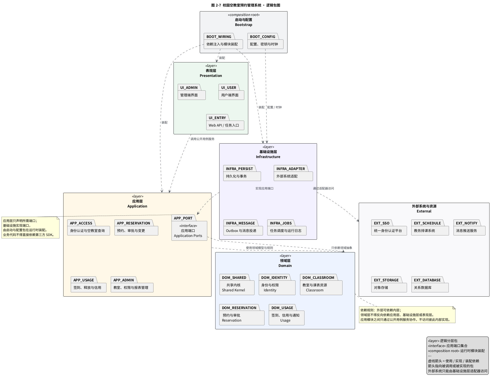

# 校园空教室预约管理系统 · 系统分析与包图

| 项目 | 内容 |
| --- | --- |
| 课程 | 面向对象设计与分析 · 学期课设 |
| 选题 | 校园空教室预约管理系统（Campus Free Classroom Reservation Management System, CFRMS） |
| 阶段 | 系统分析（分析模型 → 包图与接口模型） |
| 交付内容 | 逻辑包图、包职责说明、依赖约束、用况与顺序图追溯 |
| 上游模型 | `../user-case-analysis/用况分析.md`、`../class-analysis/类图分析.md` |
| 关联模型 | `接口与顺序图设计.md` |
| 报告对应 | 2.3 包图与分层设计 |
| 图号 | 图 2-7 校园空教室预约管理系统逻辑包图 |
| 版本 | v1.0 |

---

## 0 文档定位与建模口径

### 0.1 阶段衔接

用况分析建立了需求模型，类图分析把用况推进为边界类、控制类和实体类，接口与顺序图进一步给出了核心交互的实现契约。本包图承接这些模型，回答系统应按什么职责边界组织、模块之间允许沿什么方向依赖，以及外部系统在何处接入。

| 上游产物 | 进入包图的信息 | 本图对应位置 |
| --- | --- | --- |
| 17 个用况与 3 类分析类 | 用户意图、业务协调、业务数据与规则 | 表现层、应用层、领域层 |
| 接口与顺序图 | 仓储、认证、课表、通知、文件等端口和外部调用 | 应用端口、基础设施层、外部系统与资源 |
| NFR-02～NFR-07 | 事务、幂等、降级、通知重试、可配置与可观测 | 持久化、Outbox、适配器、启动与配置 |

### 0.2 包图表达的是逻辑结构

图中的包是逻辑模块和依赖边界，不对应当前仓库中的 `user-case-analysis/`、`class-analysis/`、`system-design/` 文档目录，也不强制采用微服务部署。

当前模型可以采用“模块化单体 + 独立定时任务”的方式实现：各包先在一个部署单元中通过进程内接口协作，后续只有在确有独立扩缩容或故障隔离需求时才拆分服务。包边界和依赖规则仍然有效。

---

## 1 包的划分

### 1.1 包清单

| 包 | 子包 | 主要职责 | 主要来源 |
| --- | --- | --- | --- |
| 表现层 `Presentation` | 用户端界面、管理端界面、Web API / 任务入口 | 接收请求、呈现结果、提供调度任务入口；不实现业务规则 | 边界类、REST 接口清单 |
| 应用层 `Application` | 身份认证与空教室查询、预约审批与变更、签到释放与信用、教室权限与报表、应用端口 | 编排用例、控制事务边界、调用领域规则和端口 | 控制类、UC-01～UC-17 |
| 领域层 `Domain` | 共享内核、身份与权限、教室与课表资源、预约与审批、签到信用与通知 | 保存实体、值对象、状态转换和业务不变式 | 领域实体类、BR-01～BR-12 |
| 基础设施层 `Infrastructure` | 持久化与事务、外部系统适配、Outbox 与消息投递、任务调度与运行日志 | 实现端口，处理数据库、第三方协议、消息重试和任务运行 | `IdentityPort`、`ReservationRepository`、`NotificationPort` 等 |
| 启动与配置 `Bootstrap` | 依赖注入与模块装配、配置密钥与时钟 | 在运行时组合各层，提供配置、密钥和统一时钟；不承载业务 | NFR-04、NFR-06、NFR-07 |
| 外部系统与资源 `External` | SSO、教务排课、消息推送、对象存储、关系数据库 | 本系统边界外的依赖，不是本系统自有包 | 用况参与者与接口设计 |

### 1.2 应用层模块

| 模块 | 包含的主要控制类 | 负责的用况 |
| --- | --- | --- |
| 身份认证与空教室查询 `APP_ACCESS` | 登录控制器、空教室查询控制器 | UC-01、UC-02 |
| 预约审批与变更 `APP_RESERVATION` | 预约控制器、预约规则校验器、审批控制器 | UC-03、UC-04、UC-05、UC-06、UC-07、UC-08、UC-09 |
| 签到、释放与信用 `APP_USAGE` | 签到控制器、超时未签到释放任务、违约与信用控制器、通知服务 | UC-10、UC-11、UC-12、UC-17 |
| 教室、权限与报表管理 `APP_ADMIN` | 教室管理控制器、用户与权限控制器、统计报表控制器、课表同步服务 | UC-13、UC-14、UC-15、UC-16 |

应用模块之间不直接访问彼此的内部类。需要协作时，只调用对方公开的应用用例服务；这种约束使 `预约控制器 → 违约与信用控制器` 等跨模块协作仍保留可替换的接口。

---

## 2 逻辑包图



> 源文件：`diagrams/package-diagram.puml`；矢量图：`diagrams/svg/包图-校园空教室预约管理系统.svg`。

图中使用虚线箭头表示“使用 / 实现 / 装配”依赖，箭头指向被调用或被实现的包。为避免跨层细节把图面连线绞在一起，包图只保留分层级依赖；控制类到实体类的细化关系见第 3 节和 `../class-analysis/类图分析.md`。

---

## 3 包依赖设计

### 3.1 分层依赖

| 源包 | 目标包 | 依赖含义 | 约束 |
| --- | --- | --- | --- |
| 表现层 | 应用层 | 调用登录、查询、预约、审批、签到、释放和管理用例 | 表现层只传 DTO / 命令对象，不直接访问仓储或实体 |
| 应用层 | 领域层 | 调用领域对象、值对象和业务规则 | 应用层不把外部 SDK 类型带入领域层 |
| 应用端口 | 领域层 | 用领域类型定义端口契约 | 端口只声明能力，不包含数据库或 HTTP 实现 |
| 基础设施层 | 应用端口 | 实现仓储、认证、课表、通知、文件等端口 | 适配器不得把第三方错误结构直接透传给上层 |
| 基础设施层 | 外部系统与资源 | 执行 SQL、OIDC、课表同步、文件存取和消息投递 | 只有基础设施层可以依赖第三方 SDK |
| 启动与配置 | 表现层、应用层、基础设施层 | 创建对象、注入实现、加载配置并注册任务 | 组合根不参与业务判断，其他包不得反向依赖它 |

这张依赖表同时给出包级无环约束：

```text
表现层 → 应用层 → 领域层
基础设施层 → 应用端口 → 领域层
启动与配置 → 表现层 / 应用层 / 基础设施层
基础设施层 → 外部系统与资源
```

`基础设施层 → 应用端口` 并不表示业务层反向依赖基础设施；它表示适配器实现应用声明的端口。运行时由启动与配置包完成绑定。

### 3.2 子包级依赖

| 源子包 | 目标子包 | 依赖原因 |
| --- | --- | --- |
| `UI_USER` | `APP_ACCESS`、`APP_RESERVATION`、`APP_USAGE` | 用户完成登录、查询、预约、取消、变更和签到 |
| `UI_ADMIN` | `APP_RESERVATION`、`APP_ADMIN` | 管理员执行审批、教室管理、信用管理和统计 |
| `UI_ENTRY` | `APP_USAGE`、`APP_ADMIN` | 调度器触发超时释放，管理入口触发课表同步和报表导出 |
| `APP_ACCESS` | `DOM_IDENTITY`、`DOM_CLASSROOM`、`APP_PORT` | 加载身份权限并合并教室、课表和预约信息 |
| `APP_RESERVATION` | `DOM_RESERVATION`、`DOM_CLASSROOM`、`DOM_IDENTITY`、`APP_PORT` | 编排校验、占位、审批和通知 |
| `APP_USAGE` | `DOM_USAGE`、`DOM_RESERVATION`、`DOM_IDENTITY`、`APP_PORT` | 处理签到、释放、违约、信用和通知 |
| `APP_ADMIN` | `DOM_IDENTITY`、`DOM_CLASSROOM`、`DOM_RESERVATION`、`DOM_USAGE`、`APP_PORT` | 处理教室维护、权限、课表同步和统计 |
| `DOM_RESERVATION` | `DOM_CLASSROOM`、`DOM_IDENTITY`、`DOM_SHARED` | 预约必须引用教室、申请人和公共值对象 |
| `DOM_USAGE` | `DOM_RESERVATION`、`DOM_IDENTITY`、`DOM_SHARED` | 签到、违约和释放均围绕既有预约与用户信用 |
| `DOM_IDENTITY`、`DOM_CLASSROOM` | `DOM_SHARED` | 复用用户标识、时段、状态等公共抽象 |

领域子包内部的推荐依赖顺序为：

```text
DOM_SHARED
  ↑
DOM_IDENTITY / DOM_CLASSROOM
  ↑
DOM_RESERVATION
  ↑
DOM_USAGE
```

`DOM_SHARED` 只能包含稳定的值对象、标识、错误分类和时间抽象，不能依赖其他领域子包。

### 3.3 禁止依赖

| 禁止关系 | 原因 |
| --- | --- |
| 表现层直接依赖领域实体或基础设施实现 | 会绕过应用层的事务、鉴权和状态编排 |
| 领域层依赖应用层、表现层、基础设施层 | 业务规则会被界面协议或数据库实现污染 |
| 应用层依赖具体 JDBC / HTTP / 消息客户端 | 破坏端口抽象，无法替换外部实现或进行测试替身 |
| 任意包直接调用第三方 SDK 并透传其异常 | 破坏错误码、降级和脱敏策略 |
| 应用模块直接访问其他模块的内部仓储或实体 | 形成隐式耦合，放大修改影响 |
| 基础设施层依赖表现层 | 适配器不应知道调度任务或页面如何展示 |

### 3.4 应用端口与实现

| 端口 | 声明位置 | 实现位置 | 外部依赖 |
| --- | --- | --- | --- |
| `IdentityPort` | 应用端口 | 外部系统适配 | 统一身份认证平台 |
| `ScheduleOccupancyPort` | 应用端口 | 外部系统适配 | 教务排课系统 |
| `ReservationRepository` | 应用端口 | 持久化与事务 | 关系数据库 |
| `NotificationPort` | 应用端口 | Outbox 与消息投递 | 消息推送服务 |
| `FileStoragePort` | 应用端口 | 外部系统适配 | 对象存储 |
| `ClockPort` | 应用端口 | 启动与配置提供实现 | 系统时钟 / 测试固定时钟 |
| `StatsExportPort` | 应用端口 | 持久化与消息投递协作 | 对象存储、导出任务 |

端口只定义业务所需的方法和领域类型。认证令牌、第三方响应体、SQL 异常等实现细节留在基础设施层，并转换为统一业务错误。

---

## 4 用况到包的追溯

| 用况 | 表现层入口 | 应用层模块 | 领域包 | 主要端口 / 基础设施 |
| --- | --- | --- | --- | --- |
| UC-01 登录与身份认证 | `UI_USER`、`UI_ADMIN` | `APP_ACCESS` | `DOM_IDENTITY` | `IdentityPort`、SSO 适配器 |
| UC-02 查询空教室 | `UI_USER` | `APP_ACCESS` | `DOM_CLASSROOM`、`DOM_RESERVATION` | 课表、预约查询端口 |
| UC-03 提交预约申请 | `UI_USER` | `APP_RESERVATION` | `DOM_RESERVATION`、`DOM_CLASSROOM`、`DOM_IDENTITY` | `ReservationRepository`、`NotificationPort` |
| UC-04 校验预约可用性 | —（被调用） | `APP_RESERVATION` | `DOM_RESERVATION`、`DOM_CLASSROOM` | 课表与预约查询端口 |
| UC-05 提交证明材料 | `UI_USER` | `APP_RESERVATION` | `DOM_RESERVATION` | `FileStoragePort` |
| UC-06 审批预约申请 | `UI_ADMIN` | `APP_RESERVATION` | `DOM_RESERVATION`、`DOM_CLASSROOM` | `ReservationRepository`、`NotificationPort` |
| UC-07 取消预约 | `UI_USER` | `APP_RESERVATION`、`APP_USAGE` | `DOM_RESERVATION`、`DOM_USAGE` | 预约仓储、通知端口 |
| UC-08 变更预约 | `UI_USER` | `APP_RESERVATION` | `DOM_RESERVATION`、`DOM_CLASSROOM` | 预约仓储、课表端口 |
| UC-09 查询我的预约 | `UI_USER` | `APP_RESERVATION` | `DOM_RESERVATION` | 预约查询端口 |
| UC-10 签到核验 | `UI_USER` | `APP_USAGE` | `DOM_USAGE`、`DOM_RESERVATION` | 预约仓储、通知端口 |
| UC-11 超时未签到自动释放 | `UI_ENTRY`（调度器） | `APP_USAGE` | `DOM_USAGE`、`DOM_RESERVATION` | 任务调度、持久化、Outbox |
| UC-12 违约与信用管理 | `UI_ADMIN` | `APP_USAGE`、`APP_ADMIN` | `DOM_USAGE`、`DOM_IDENTITY` | 违约与信用仓储 |
| UC-13 管理教室信息 | `UI_ADMIN` | `APP_ADMIN` | `DOM_CLASSROOM` | 教室仓储 |
| UC-14 同步课表占用数据 | `UI_ENTRY`、`UI_ADMIN` | `APP_ADMIN` | `DOM_CLASSROOM` | 课表端口、定时任务 |
| UC-15 维护用户与权限 | `UI_ADMIN` | `APP_ADMIN` | `DOM_IDENTITY` | 用户与角色仓储 |
| UC-16 查看统计报表 | `UI_ADMIN` | `APP_ADMIN` | `DOM_RESERVATION`、`DOM_CLASSROOM`、`DOM_USAGE` | 统计查询、导出端口 |
| UC-17 发送消息通知 | —（被包含） | `APP_RESERVATION`、`APP_USAGE` | `DOM_USAGE` | `NotificationPort`、Outbox、消息适配器 |

追溯关系说明：

- 每个主要用况都有唯一的表现层入口和明确的应用层用例服务；
- UC-04 保留为内部被包含用况，没有单独的浏览器页面；
- UC-17 不向外部开放独立 REST 端点，由应用层通过通知端口触发；
- 定时释放仍从表现层的“任务入口”进入，但入口只负责调用应用用例，不包含扫描和状态判断。

---

## 5 与现有模型的一致性

### 5.1 与分析类图的对应

| 分析类类型 | 包图中的落点 | 说明 |
| --- | --- | --- |
| 用户界面边界类 | 表现层 `UI_USER`、`UI_ADMIN` | 只负责表单、列表、审批详情和结果展示 |
| 外部适配器边界类 | 应用端口 + 基础设施层 | 在分析图中是系统边界；在包图中由端口契约和适配器实现共同完成 |
| 控制类 | 应用层四个模块 | 一个控制类只归属于一个应用模块，跨模块协作走公开用例服务 |
| 实体类、值对象、枚举 | 领域层子包 | 业务不变式、状态迁移和规则仍由领域对象及应用规则校验器承担 |

### 5.2 与顺序图的对应

| 顺序图 | 包图中的关键路径 |
| --- | --- |
| 图 2-8 UC-03 提交预约申请 | `UI_USER → APP_RESERVATION → DOM_RESERVATION / DOM_CLASSROOM → APP_PORT → INFRA_PERSIST / INFRA_ADAPTER` |
| 图 2-9 UC-06 审批预约申请 | `UI_ADMIN → APP_RESERVATION → DOM_RESERVATION → APP_PORT → INFRA_PERSIST / INFRA_MESSAGE` |
| 图 2-10 UC-10 签到核验 | `UI_USER → APP_USAGE → DOM_USAGE / DOM_RESERVATION → APP_PORT → INFRA_PERSIST` |
| 图 2-11 UC-11 超时未签到自动释放 | `UI_ENTRY → APP_USAGE → DOM_USAGE → APP_PORT → INFRA_JOBS / INFRA_PERSIST / INFRA_MESSAGE` |

### 5.3 与接口设计的对应

- REST 接口位于表现层的 Web 入口，按职责转调 `APP_ACCESS`、`APP_RESERVATION`、`APP_USAGE`、`APP_ADMIN`；
- `Idempotency-Key`、`If-Match`、事务、行锁和区间排除约束分别落在应用编排与持久化实现；
- `ScheduleOccupancyPort` 无法使用时，`APP_ACCESS` 接收 `DEGRADED` 数据质量标记并在响应中明确提示；
- Outbox 事件在持久化事务内写入，提交后由基础设施层的消息投递器异步发送。

### 5.4 关键业务规则落点

| 规则 | 主要落点 |
| --- | --- |
| BR-03 时间窗、时长与提前量 | `DOM_RESERVATION` + `APP_RESERVATION` 规则校验 |
| BR-04 同一教室同一时段互斥 | `DOM_RESERVATION` 状态不变式 + `INFRA_PERSIST` 数据库约束 |
| BR-05 用途驱动审批 | `DOM_RESERVATION` + `DOM_SHARED` 枚举规则 |
| BR-07 违约与信用限制 | `DOM_USAGE` + `APP_USAGE` |
| BR-09 24 小时审批时限 | `APP_RESERVATION` + `INFRA_JOBS` 提醒任务 |
| BR-11 材料要求 | `APP_RESERVATION` + `FileStoragePort` |
| BR-12 审计与留存 | `INFRA_PERSIST` + `INFRA_JOBS` 运行日志 |

---

## 6 建模取舍

1. **按业务能力划分应用模块，而不是按技术类型划分。** 预约、审批与变更放在同一模块，使 UC-03、UC-06、UC-08 共用同一套状态和规则；避免出现“控制器包、服务包、DAO 包”之间大量横向依赖。
2. **领域层保持无框架依赖。** 数据库、HTTP、消息和文件存储都通过端口接入，业务规则可以在不启动外部服务的条件下测试。
3. **外部适配器在分析类和包图中承担不同细化职责。** 分析类把它视为系统边界，包图进一步拆成应用端口和基础设施适配器，避免业务代码直接依赖第三方 SDK。
4. **通知使用 Outbox。** 预约、审批和自动释放先提交业务事务，再异步投递通知，满足 NFR-02 的幂等和 NFR-07 的可观测性。
5. **定时任务有独立入口。** `UI_ENTRY` 只接收调度触发器并鉴权，真正的扫描、锁和状态判断在 `APP_USAGE` 与领域层完成。
6. **不把包图等同部署图。** 当前设计允许模块化单体部署；外部 SSO、课表、消息、存储和数据库才是部署边界外的依赖。

---

## 7 一致性检查

- 包图覆盖 17 个用况、8 个边界类、13 个控制类，以及完整的领域实体与值对象集合；
- 表现层不直接依赖领域实体或基础设施实现；
- 领域层不依赖任何外层包；
- 应用模块只依赖应用端口和领域模型，不依赖第三方 SDK；
- 外部系统只由基础设施适配器访问；
- 启动与配置只负责装配，不包含业务判断；
- UC-03、UC-06、UC-10、UC-11 的顺序图路径都能落到包图中的具体子包；
- 包图中的端口名称与 `接口与顺序图设计.md` 的内部端口表一致。

---

## 附录 A 文件与渲染

| 文件 | 说明 |
| --- | --- |
| `系统设计与包图.md` | 本文档：包划分、依赖规则、用况追溯与建模取舍 |
| `diagrams/package-diagram.puml` | 图 2-7 逻辑包图源文件 |
| `diagrams/png/包图-校园空教室预约管理系统.png` | 图 2-7 位图，可直接插入报告 |
| `diagrams/svg/包图-校园空教室预约管理系统.svg` | 图 2-7 矢量图，排版放大不失真 |
| `接口与顺序图设计.md` | 包图对应的接口契约与 4 张核心顺序图 |

在 `system-design/` 目录重新渲染包图：

```bash
java -jar ../class-analysis/tools/plantuml.jar \
  -charset UTF-8 -tpng -o png diagrams/package-diagram.puml
java -jar ../class-analysis/tools/plantuml.jar \
  -charset UTF-8 -tsvg -o svg diagrams/package-diagram.puml
```

包图的自动布局依赖 Graphviz 的 `dot`。若机器没有 Graphviz，可改用 PlantUML 内置布局：

```bash
java -jar ../class-analysis/tools/plantuml.jar \
  -Playout=smetana -charset UTF-8 -tpng -o png diagrams/package-diagram.puml
```
