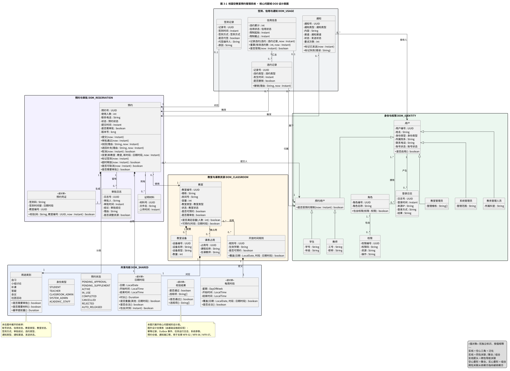

# 校园空教室预约管理系统 · 问题域设计（OOD）

| 项目 | 内容 |
| --- | --- |
| 课程 | 面向对象设计与分析 · 学期课设 |
| 选题 | 校园空教室预约管理系统（Campus Free Classroom Reservation Management System, CFRMS） |
| 阶段 | 系统设计（OOA 分析模型 → OOD 问题域设计类模型） |
| 交付内容 | 核心问题域 OOD 设计类图、OOD 修改说明、OOA → OOD 类映射表 |
| 上游模型 | `../class-analysis/类图分析.md`（领域实体类图、分析类图） |
| 关联模型 | `系统设计与包图.md`（分层与领域子包）、`接口与顺序图设计.md`（应用端口与交互契约） |
| 报告对应 | 3.1 问题域设计的修改 |
| 图号 | 图 3-1 校园空教室预约管理系统 · 核心问题域 OOD 设计类图 |
| 版本 | v1.0 |

---

## 0 阶段定位与设计范围

### 0.1 从 OOA 到 OOD

OOA 阶段已经给出两张模型：**领域实体类图**表达实体之间的泛化、聚合、组合、关联与多重度；**分析类图**把 17 个用况映射为 8 个边界类、13 个控制类和 15 组（展开为 23 个）实体类。OOD 阶段不再重新识别问题域，而是在这份分析模型上做面向实现的修改与完善：

1. **补全设计信息**：为属性和方法补齐可见性、具体类型、参数与返回值，为关联补齐导航性和多重度；
2. **重新分配职责**：把用况编排从实体类移到应用服务，实体类只保留状态迁移和业务不变式；
3. **细化值对象与枚举**：把 OOA 中含义过宽的值对象拆开，把状态、类型、结论等固定为枚举；
4. **补充设计支撑类**：为幂等、并发、异步通知、任务运行和配置增加设计类；
5. **保持可追溯**：每个 OOA 类都能在 OOD 模型中找到落点，映射关系见第 3 节。

### 0.2 设计范围

本部分的“核心问题域”指领域层中的实体、值对象和枚举，对应 `系统设计与包图.md` 的 `DOM_SHARED`、`DOM_IDENTITY`、`DOM_CLASSROOM`、`DOM_RESERVATION`、`DOM_USAGE` 五个子包。

边界类和控制类不在图 3-1 中展开，但它们是 OOD 模型的一部分：边界类落到表现层的视图与 API 设计类，控制类落到应用层的应用服务，外部适配器落到基础设施层。视图与 API 设计类分别归属 `UI_USER`、`UI_ADMIN`、`UI_ENTRY`，应用服务归属 `APP_*`，适配器归属 `INFRA_ADAPTER`，端口归属 `APP_PORT`。这些类的映射统一列在第 3 节的表 3-5 中。人机界面布局、控制流细节和数据接口设计属于系统设计的后续小节，本部分不重复展开。

---

## 1 OOA → OOD 的必要修改

### 1.1 设计原则

- **领域层无框架依赖**：领域类只引用领域类型、`UUID`、`Instant`、`LocalDate` 等基础类型，不出现 HTTP、SQL、消息客户端类型。
- **实体负责不变式，服务负责编排**：实体方法只完成状态迁移和规则判断；跨实体、跨仓储、跨外部系统的流程放到应用服务。
- **值对象不可变**：`日期时段`、`每周时段`、`预约凭证`、`校验结果` 按值相等，创建后不修改。
- **状态显式化**：预约状态、身份类型、账号状态、信用状态等使用枚举，禁止以字符串魔法值表达。
- **与既有模型一致**：类名、包名、端口名和状态名沿用 `类图分析.md`、`系统设计与包图.md`、`接口与顺序图设计.md` 的约定。

### 1.2 修改清单

表 3-1　OOA → OOD 的必要修改

| 编号 | 修改点 | OOD 处理 | 原因与影响 |
| --- | --- | --- | --- |
| M1 | 实体职责收敛 | 实体类只保留状态迁移和不变式；查询空教室、提交预约、审批、签到等用况编排移到应用服务；签到记录、违约记录由应用服务创建 | 实体不依赖仓储和外部系统；`预约` 也不会反向依赖 `DOM_USAGE`，领域层可在不启动数据库、不调用 SSO 的条件下测试 |
| M2 | 身份子类可设计化 | `用户` 明确 `UUID` 标识与账号状态；`学生` 增加学号、年级，`教师` 增加工号、职称，`教室管理员` 增加管理楼栋，`系统管理员` 增加管理范围，`教务管理人员` 增加所属科室 | OOA 中多个子类没有属性差异，OOD 需要给出可实现的差异化数据 |
| M3 | 时段值对象细分 | `时段` 拆为 `日期时段`（日期 + 起止时刻）和 `每周时段`（星期 + 起止时刻） | 开放时间规则是每周重复，不含具体日期；单一时段会让规则产生非法状态 |
| M4 | 预约凭证抽取 | 签到码、签到时间窗、教室标识抽为 `预约凭证` 值对象，提供 `校验()` | 凭证校验内聚，预约类不膨胀，签到与门禁适配器可复用同一套校验 |
| M5 | 并发与幂等 | `预约` 增加 `版本号`；新增图外支撑类 `幂等记录` | 支撑 `If-Match`、`Idempotency-Key`，以及签到与自动释放对同一预约的竞争 |
| M6 | 状态显式化 | `预约状态` 明确 8 个取值；`身份类型`、`账号状态`、`信用状态`、`教室状态`、`签到方式`、`审批结论`、`违约类型`、`通知类型` 等枚举化 | OOA 只给出状态名，OOD 固定取值集合，便于状态迁移和持久化 |
| M7 | 规则策略化 | `预约规则校验器` 拆为 `ReservationPolicy` 接口与时间窗、容量、冲突、信用、在途、材料六个规则实现 | 规则可独立测试和替换；`ReservationPolicy` 仍是 UC-04 的唯一入口 |
| M8 | 开放规则关联调整 | OOA 的 `教室 ◇— 开放时间规则` 聚合改为 `教室 0..* — 0..* 开放时间规则` 的可复用关联 | 开放规则按学期、楼栋维护，可复用于多间教室；聚合会错误表达“规则随教室删除” |
| M9 | 通知接收者与投递分离 | `通知` 增加与 `用户` 的接收关联；新增 `OutboxEvent` 承载异步投递 | OOA 只表达“预约触发通知”，未表达接收者；Outbox 使业务事务与外部推送解耦 |
| M10 | 信用按需创建 | `预约用户 1 — 1 信用信息` 改为 `1 — 0..1`；`信用信息` 增加汇总 `违约记录` 的关联 | 新用户首次预约或首次违约时才建立信用档案；信用重算有明确的数据来源 |

> 说明：`预约.取消()` 返回“是否需要记违约”，`预约.超时释放()` 返回“是否由本次调用完成释放”，`预约.标记签到()` 只改变预约状态；`违约记录` 和 `签到记录` 由应用服务在相应事务中创建。这样 `DOM_RESERVATION` 不会反向依赖 `DOM_USAGE`，领域子包依赖保持单向。

### 1.3 OOD 新增设计类

表 3-2　OOD 新增设计类

| 编号 | 新增类 | 层 / 类型 | 职责 | 对应问题 |
| --- | --- | --- | --- | --- |
| N1 | `校验结果` | 领域层 / 值对象 | 封装是否通过、违规项列表 | OOA 只把“校验结果”作为返回类型名，未建模 |
| N2 | `身份类型`、`账号状态`、`信用状态`、`教室类型`、`教室状态`、`签到方式`、`审批结论`、`违约类型`、`通知类型`、`通知渠道`、`发送状态` | 领域层 / 枚举 | 固定属性取值，替代字符串常量 | OOA 只写类型名，未给出取值集合 |
| N3 | `幂等记录` | 基础设施层 / 实体 | 保存幂等键、请求摘要、首次结果和过期时间 | NFR-02 的重复提交与重试 |
| N4 | `OutboxEvent` | 基础设施层 / 实体 | 与业务事务同提交的通知事件，记录投递状态和重试次数 | NFR-02、NFR-07 |
| N5 | `任务运行日志` | 基础设施层 / 实体 | 记录 `runId`、处理数、释放数、跳过数、失败数 | NFR-07 的定时任务可观测性 |
| N6 | `系统参数` | 启动与配置 / 值对象 | 违约阈值、可预约天数、单次时长上限等 | NFR-06 的可配置性 |
| N7 | `ReservationPolicy` + 六个规则实现 | 应用层 / 服务 + 策略 | 统一执行 UC-04 的可用性校验 | OOA 的 `预约规则校验器` 需要可测试的拆分 |
| N8 | `ReservationRepository`、`IdentityPort`、`ScheduleOccupancyPort`、`NotificationPort`、`FileStoragePort`、`ClockPort`、`StatsExportPort` | 应用端口 / 基础设施 | 持久化与外部系统的抽象 | 接口设计中的端口契约 |

> 说明：N3～N6 不画入图 3-1，因为它们不属于核心问题域的实体语义；图 3-1 以注释说明它们的存在，具体契约见 `系统设计与包图.md` 与 `接口与顺序图设计.md`。

---

## 2 核心问题域 OOD 设计类图

### 2.1 设计类图



> 源文件：`diagrams/class-diagram-ood-domain.puml`；矢量图：`diagrams/svg/类图-问题域OOD设计类图.svg`。

图 3-1 按 `DOM_SHARED`、`DOM_IDENTITY`、`DOM_CLASSROOM`、`DOM_RESERVATION`、`DOM_USAGE` 五个领域子包组织。属性前的 `-` 表示私有，`+` 表示公开（本图未使用 `#` 受保护属性）；方法参数和返回值均给出设计类型。实体之间的关联只表达对象引用和导航方向，持久化外键由基础设施层映射，不在领域类中重复声明。成图使用 Graphviz 的 `dot` 布局，并通过 `skinparam linetype ortho` 采用正交走线，减少斜线交叉。

### 2.2 类间关系的 OOD 调整

表 3-3　OOD 中新增或调整的类间关系

| 关系 | OOD 多重度 | 处理 | 说明 |
| --- | --- | --- | --- |
| 教室 — 开放时间规则 | `0..*` — `0..*` | 由聚合改为可复用关联 | 规则按学期、楼栋维护，可复用于多间教室 |
| 信用信息 — 预约用户 | `0..1` — `1` | 由 `1 — 1` 放宽 | 信用档案在首次信用事件时创建，由信用信息导航到用户 |
| 预约 — 日期时段 | `1` — `1`（组合） | 由 `0..* — 1` 收紧 | 每条预约独占一个具体时段值 |
| 预约 — 用途类别 | `1` — `1`（枚举） | 由 `0..* — 1` 收紧 | 每条预约属于一个用途类别 |
| 预约 — 预约凭证 | `1` — `1`（组合） | 新增 | 凭证随预约创建，保存签到码与签到时间窗 |
| 开放时间规则 — 每周时段 | `1` — `1`（组合） | 新增 | 规则定义每周重复的可预约时段 |
| 课表占用 — 日期时段 | `1` — `1`（组合） | 由 `0..* — 1` 收紧 | 每条课表占用对应一个具体时段 |
| 通知 — 用户 | `0..*` — `1` | 新增 | 明确通知接收者，依赖方向为 `DOM_USAGE → DOM_IDENTITY` |
| 信用信息 — 违约记录 | `1` — `0..*` | 新增 | 信用档案汇总有效违约记录 |
| 用户 — 角色、角色 — 权限 | `1..*` — `0..*` | 保留 | RBAC 模型不变 |
| 教室 — 教室设备 | `1` — `0..*`（组合） | 保留 | 设备随教室删除 |
| 签到记录 — 预约 | `0..1` — `1` | 保留 | 签到记录导航到预约，依赖方向为 `DOM_USAGE → DOM_RESERVATION` |
| 预约 — 审批日志 / 证明材料 | `1` — `0..*` | 保留 | 同包内的审计与材料追溯 |
| 违约记录 / 通知 — 预约 | `0..*` — `1` | 保留 | 跨包时由违约记录、通知导航到预约 |

> 跨子包关联统一从依赖方指向被依赖方：`DOM_RESERVATION → DOM_IDENTITY / DOM_CLASSROOM`，`DOM_USAGE → DOM_RESERVATION / DOM_IDENTITY`。因此表中部分跨子包关系的两端顺序与 OOA 领域实体类图相反，但语义不变。

### 2.3 预约状态迁移

`预约` 的状态集合由 OOA 的文字描述收敛为 8 个枚举值。状态迁移只能通过 `预约` 的领域方法完成，应用服务负责在事务边界内调用。

表 3-4　预约状态迁移

| 当前状态 | 事件 | 下一状态 | 约束 |
| --- | --- | --- | --- |
| `PENDING_APPROVAL` | 审批通过 | `ACTIVE` | 复核资源冲突，生成预约凭证 |
| `PENDING_APPROVAL` | 驳回 | `REJECTED` | 必须填写理由，释放时段 |
| `PENDING_APPROVAL` | 退回补充 | `PENDING_SUPPLEMENT` | 保留时段 24 小时 |
| `PENDING_APPROVAL` / `PENDING_SUPPLEMENT` | 取消 | `CANCELLED` | 释放保留时段，待审批申请取消不记违约 |
| `PENDING_SUPPLEMENT` | 补交材料 | `PENDING_APPROVAL` | 材料齐备后重新进入审批 |
| `PENDING_SUPPLEMENT` | 逾期未补交 | `REJECTED` | 自动驳回并释放时段 |
| `ACTIVE` | 签到 | `IN_USE` | 签到窗内、凭证有效、教室匹配 |
| `ACTIVE` | 取消 | `CANCELLED` | 按是否临近开始时间判断是否记违约 |
| `ACTIVE` | 超时未签到 | `AUTO_RELEASED` | 开始后 10 分钟仍无有效签到 |
| `ACTIVE` | 变更教室或时段 | `PENDING_APPROVAL` / `ACTIVE` | 需审批类重新审批，即时类直接生效 |
| `IN_USE` | 到达结束时间 | `COMPLETED` | 释放时段并结束使用 |

---

## 3 OOA → OOD 类映射

### 3.1 映射表

> 映射关系描述的是**一个 OOA 类在 OOD 模型中被几个设计类承载**，不是对象之间的多重度。`1 to m` 表示 OOA 类被拆分或展开为 m 个 OOD 设计类；`1 to 1` 表示保留同名职责并补齐设计信息。OOD 模型类列中的视图、API、应用服务、适配器和端口不画在图 3-1 中，它们的包位置遵循 `系统设计与包图.md`。

表 3-5　OOA → OOD 类映射

| # | OOA 模型类（类别） | OOD 模型类（所在层） | 映射关系 | 演化说明 |
| --- | --- | --- | --- | --- |
| 1 | 登录界面（边界） | `LoginView` + `SessionApi`（表现层） | 1 to 2 | 视图与会话接口分离；对应 `/auth/sessions`、`/me` |
| 2 | 空教室查询界面（边界） | `ClassroomQueryView` + `AvailabilityApi`（表现层） | 1 to 2 | 查询表单 / 列表与 `/classrooms/available` 契约分离 |
| 3 | 预约申请界面（边界） | `ReservationFormView` + `ReservationApi` + `FileApi`（表现层） | 1 to 3 | 表单、预约命令与材料上传拆成独立接口 |
| 4 | 我的预约 / 签到界面（边界） | `MyReservationsView` + `CheckInView` + `ReservationApi`（表现层） | 1 to 3 | 列表 / 详情与扫码签到分视图，复用预约接口 |
| 5 | 预约审批界面（边界） | `ApprovalWorkbenchView` + `ApprovalApi`（表现层） | 1 to 2 | 待办工作台与审批决定接口分离 |
| 6 | 教室管理界面（边界） | `ClassroomAdminView` + `ClassroomApi`（表现层） | 1 to 2 | 维护界面与教室 / 开放规则接口分离 |
| 7 | 用户 / 权限 / 统计界面（边界） | `AdminConsoleView` + `UserAdminApi` + `ViolationApi` + `ReportApi`（表现层） | 1 to 4 | 权限、违约、报表三类能力拆成独立 API |
| 8 | 外部适配器（边界） | `IdentityAdapter` + `ScheduleAdapter` + `NotificationAdapter` + `AccessControlAdapter`（基础设施层） | 1 to 4 | 按外部系统拆分适配器；门禁适配器为可选项，当前签到以二维码 / 签到码为主 |
| 9 | 登录控制器（控制） | `AuthApplicationService`（应用层） | 1 to 1 | SSO 换码、角色权限加载、会话与登录日志 |
| 10 | 空教室查询控制器（控制） | `ClassroomAvailabilityService`（应用层） | 1 to 1 | 合并课表、预约、教室状态；支持 `DEGRADED` |
| 11 | 预约控制器（控制） | `ReservationApplicationService`（应用层） | 1 to 1 | 幂等、校验、占位、事务与 Outbox 编排 |
| 12 | 预约规则校验器（控制） | `ReservationPolicy` + `TimeWindowRule` + `CapacityRule` + `OverlapRule` + `CreditRule` + `InFlightRule` + `MaterialRule`（应用层） | 1 to 7 | 策略模式；`ReservationPolicy` 仍是 UC-04 单入口 |
| 13 | 审批控制器（控制） | `ApprovalApplicationService`（应用层） | 1 to 1 | `If-Match`、四种决定、审批日志与通知 |
| 14 | 签到控制器（控制） | `CheckInApplicationService`（应用层） | 1 to 1 | 归属 / 状态 / 签到窗 / 凭证校验；行锁与幂等 |
| 15 | 超时未签到释放任务（控制） | `OverdueCheckInJob` + `OverdueReleaseService`（应用层） | 1 to 2 | 扫描调度与单条释放 / 违约 / 信用编排分离 |
| 16 | 教室管理控制器（控制） | `ClassroomAdminApplicationService`（应用层） | 1 to 1 | 教室、设备、开放规则维护；停用冲突处理 |
| 17 | 违约与信用控制器（控制） | `CreditApplicationService` + `CreditPolicy`（应用层） | 1 to 2 | 信用重算规则独立，阈值可配置 |
| 18 | 用户与权限控制器（控制） | `IdentityAdminApplicationService`（应用层） | 1 to 1 | 角色 / 权限分配、账号冻结 |
| 19 | 统计报表控制器（控制） | `ReportingApplicationService` + `ReportExporter`（应用层） | 1 to 2 | 查询与异步导出分离 |
| 20 | 课表同步服务（控制） | `ScheduleSyncService` + `ScheduleOccupancyPort`（应用层） | 1 to 2 | 同步编排与外部课表端口分离 |
| 21 | 通知服务（控制） | `NotificationApplicationService` + `NotificationPort`（应用层） | 1 to 2 | 业务通知编排与投递端口分离 |
| 22 | 用户（实体） | `用户`（领域层） | 1 to 1 | 抽象类保留；明确 `UUID`、账号状态与是否启用 |
| 23 | 预约用户（实体） | `预约用户`（领域层） | 1 to 1 | 抽象类保留；增加限制判断，信用信息按需关联 |
| 24 | 学生（实体） | `学生`（领域层） | 1 to 1 | 增加学号、年级 |
| 25 | 教师（实体） | `教师`（领域层） | 1 to 1 | 增加工号、职称 |
| 26 | 教室管理员（实体） | `教室管理员`（领域层） | 1 to 1 | 增加管理楼栋 |
| 27 | 系统管理员（实体） | `系统管理员`（领域层） | 1 to 1 | 保留；明确管理范围，管理职责由应用服务实现 |
| 28 | 教务管理人员（实体） | `教务管理人员`（领域层） | 1 to 1 | 保留；明确所属科室，主要用于报表权限 |
| 29 | 角色（实体） | `角色`（领域层） | 1 to 1 | 明确 `UUID` 和权限包含关系 |
| 30 | 权限（实体） | `权限`（领域层） | 1 to 1 | 明确权限码、资源、操作 |
| 31 | 登录日志（实体） | `登录日志`（领域层） | 1 to 1 | 明确登录方式与结果 |
| 32 | 信用信息（实体） | `信用信息`（领域层） | 1 to 1 | 增加记录违约、重算、是否受限；汇总违约记录 |
| 33 | 教室（实体） | `教室`（领域层） | 1 to 1 | 明确容量判断、可预约与需审批属性 |
| 34 | 教室设备（实体） | `教室设备`（领域层） | 1 to 1 | 作为教室的组合部件 |
| 35 | 开放时间规则（实体） | `开放时间规则` + `每周时段`（领域层） | 1 to 2 | 规则改用每周时段；与教室改为可复用关联 |
| 36 | 时段（值对象） | `日期时段` + `每周时段`（领域层） | 1 to 2 | 按“具体日期”与“每周重复”拆分 |
| 37 | 课表占用（实体） | `课表占用`（领域层） | 1 to 1 | 组合 `日期时段` |
| 38 | 预约（实体） | `预约` + `预约凭证` + `预约状态`（领域层） | 1 to 3 | 增加版本号；凭证值对象化；状态枚举化 |
| 39 | 用途类别（枚举） | `用途类别`（领域层） | 1 to 1 | 枚举保留，决定审批 / 材料 / 提前量 |
| 40 | 签到记录（实体） | `签到记录`（领域层） | 1 to 1 | 增加代签原因与代签操作人 |
| 41 | 审批日志（实体） | `审批日志`（领域层） | 1 to 1 | 记录是否调整资源 |
| 42 | 违约记录（实体） | `违约记录`（领域层） | 1 to 1 | 增加撤销操作 |
| 43 | 证明材料（实体） | `证明材料`（领域层） | 1 to 1 | 保留文件元数据；内容由 `FileStoragePort` 管理 |
| 44 | 通知（实体） | `通知` + `OutboxEvent`（领域层 / 基础设施层） | 1 to 2 | 业务通知与投递事件分离；增加接收者关联 |

### 3.2 映射关系统计

44 个 OOA 类中：

- **1 to 1** 共 26 个：控制类 7 个、实体类 19 个；这些类保留原有职责，只补齐可见性、类型、方法和多重度。
- **1 to m** 共 18 个：边界类 8 个、控制类 6 个、实体类 4 个；拆分最细的是 `预约规则校验器`（1 to 7），其次是外部适配器与用户 / 权限 / 统计界面（各 1 to 4）。
- 没有 `m to 1` 或 `m to n` 映射：OOA 中的每个类都能找到明确的 OOD 落点，不需要把多个 OOA 类合并为一个设计类。

> `每周时段` 同时出现在 `开放时间规则` 和 `时段` 两行，是同一 OOD 值对象被两个 OOA 类复用的结果；统计按 OOA 类计数，不按 OOD 类去重。

---

## 4 一致性检查

- 图 3-1 的五个领域子包与 `系统设计与包图.md` 的 `DOM_SHARED`、`DOM_IDENTITY`、`DOM_CLASSROOM`、`DOM_RESERVATION`、`DOM_USAGE` 一一对应，依赖方向保持 `DOM_SHARED ← DOM_IDENTITY / DOM_CLASSROOM ← DOM_RESERVATION ← DOM_USAGE`，无反向依赖；
- 44 个 OOA 类在表 3-5 中均有映射，映射关系统计与逐行结果一致；
- 控制类到应用服务的映射与顺序图中“控制器（应用服务）”的标注一致；`ReservationPolicy`、`ReservationRepository`、`NotificationPort`、`OutboxEvent` 等名称与接口设计一致；
- 边界类到视图 / API / 适配器的映射与 `接口与顺序图设计.md` 的 REST 资源分组一致；
- 领域类只引用领域类型、`UUID`、`LocalDate`、`LocalTime`、`Instant`、`Duration`，不依赖 HTTP、SQL、消息客户端等基础设施类型；
- 预约状态取值与接口文档中的 `PENDING_APPROVAL`、`ACTIVE`、`REJECTED`、`AUTO_RELEASED` 等状态一致，状态迁移由 `预约` 的领域方法统一约束。

---

## 附录 文件与渲染

| 文件 | 说明 |
| --- | --- |
| `问题域设计.md` | 本文档：OOD 修改、设计类图、关系调整、状态迁移与 OOA → OOD 映射 |
| `diagrams/class-diagram-ood-domain.puml` | 图 3-1 源文件 |
| `diagrams/png/类图-问题域OOD设计类图.png` | 图 3-1 位图，可直接插入报告 |
| `diagrams/svg/类图-问题域OOD设计类图.svg` | 图 3-1 矢量图，排版放大不失真 |

在 `system-design/` 目录重新渲染图 3-1：

```bash
# 图 3-1 使用 Graphviz 的 dot 布局；puml 中已设置 linetype ortho
java -jar ../class-analysis/tools/plantuml.jar \
  -charset UTF-8 -tpng -o png diagrams/class-diagram-ood-domain.puml

java -jar ../class-analysis/tools/plantuml.jar \
  -charset UTF-8 -tsvg -o svg diagrams/class-diagram-ood-domain.puml
```

> 图 3-1 依赖 Graphviz 的 `dot` 进行布局，并在源文件中使用 `skinparam linetype ortho` 做正交走线。没有 Graphviz 时可追加 `-Playout=smetana` 作为后备，但布局会不同。字体使用 `Noto Sans CJK SC`，并以 `-charset UTF-8` 渲染，避免中文显示为方块。
